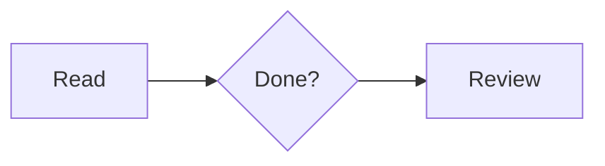

# Obsidian format examples

==**Checkbox states**==

- [ ] To do
- [/] In progress
- [x] Done
- [-] Cancelled
- [>] Forwarded
- [<] Scheduled
- [?] Question
- [!] Important
- [*] Star
- ["] Quote
- [l] Location
- [b] Bookmark
- [i] Information
- [S] Savings
- [I] Idea
- [p] Pros
- [c] Cons
- [f] Urgent
- [k] Key
- [w] Win
- [u] Up
- [d] Down
- [D] Draft PR
- [P] Open PR
- [M] Merged PR
- [+] Add
- [B] Brainstorm
- [a] Alarm
- [n] Note
- [R] Review
- [t] Time
- [L] Love

## Text and links

**Bold**, *italic*, ~~deleted~~, ==highlighted==, and `inline code`.

[[Note|Linked note]] and [[Note#Section]].

![[Note#Section]]

\[[Not an internal link]]

#example #project/review

> [!tip]+ Expanded tip
> Select text to add a comment.

> [!warning]- Collapsed warning
> Inspect source mappings before editing.


![[attachment.png|Example image|300]]

| Name | Type | Description |
| :--- | :---: | ---: |
| Highlight | Text | Visible |

```python
def hello(name: str) -> str:
    return f"Hello, {name}"
```

Inline math: $E=mc^2$.

$$
\int_0^1 x^2\,dx = \frac{1}{3}
$$



Footnote[^note] and inline note.^[Inline footnote content.]

[^note]: Footnote content.

%% Hidden comment. %%

<span style="color: var(--text-accent);">This is an HTML span.</span>

<details><summary>Expand details</summary>Additional content.</details>
